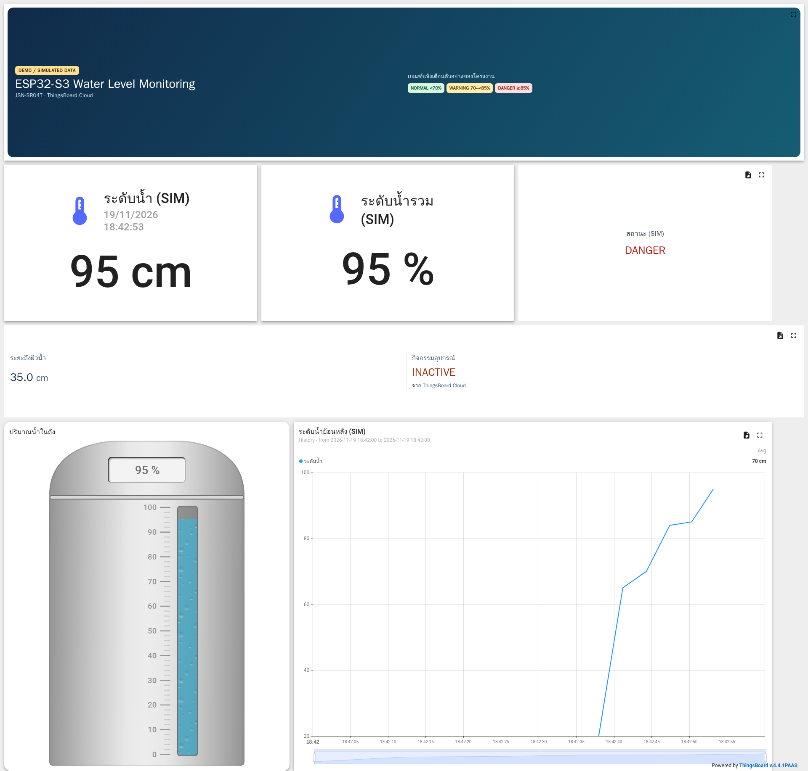

# ESP32-S3 Water Level Monitoring System

โครงงานวัดระดับน้ำด้วย JSN-SR04T และ ESP32-S3-WROOM-1-N16R8 บน PCB ออกแบบเอง ใช้ไฟจาก Power Bank USB-C 5 V บอร์ดออกแบบให้แสดงสถานะด้วย LED เขียว เหลือง แดง และ Active Buzzer พร้อมส่งข้อมูลผ่าน Wi-Fi ไปยัง ThingsBoard Cloud ซึ่งเก็บข้อมูลและแสดง Dashboard

| แหล่งข้อมูล | การไหลของข้อมูล | Device ใน ThingsBoard |
| --- | --- | --- |
| จำลอง | Windows PowerShell → HTTPS → ThingsBoard Cloud → Dashboard | `ESP32-S3-Water-Level-SIM` |
| บอร์ดจริง | JSN-SR04T → ESP32-S3 → Wi-Fi / HTTPS → ThingsBoard Cloud → Dashboard | `ESP32-S3-Water-Level` |

ชุดไฟล์นี้มีสคริปต์จำลองสำหรับทดสอบเส้นทางข้อมูลและคู่มือตั้งค่า Cloud ส่วนการทดสอบบอร์ดจริงเริ่มเมื่อมีเฟิร์มแวร์และผังขา PCB

ตัวอย่างนี้ทดสอบส่งผ่าน HTTPS เข้า ThingsBoard Cloud v4.4.1PAAS สำเร็จ 6 จุดเมื่อวันที่ 19 พฤศจิกายน 2026 ค่าล่าสุด 95 cm, 95% และ `DANGER` กราฟตัวอย่างบันทึกช่วงย้อนหลังแบบคงที่สำหรับรอบสาธิต หากส่งข้อมูลรอบใหม่แล้วต้องการดูจุดใหม่ในกราฟ ให้เปลี่ยนช่วงเวลาหรือใช้ Realtime ตามขั้นที่ 2 [ไฟล์ Export ของ Dashboard](dashboard/water-level-monitoring-dashboard.json) · [ภาพผลการทดสอบ](screenshots/dashboard-sim.png)

**Application Deployment URL** เปิดได้จากเบราว์เซอร์โดยไม่ต้องลงชื่อเข้าใช้ ThingsBoard ข้อมูลบนลิงก์นี้มาจาก Device จำลอง `ESP32-S3-Water-Level-SIM` [เปิด Water Level Monitoring Dashboard](https://thingsboard.cloud/dashboard/6a182b80-e40e-11f1-b8a1-9db681a717b8?publicId=a5b263d0-e40f-11f1-b50d-0302f5370387)

**GitHub Application Repository** [water-level-thingsboard](https://github.com/nmnichoti24-max/water-level-thingsboard)



## อ่าน Dashboard

- การ์ดระดับน้ำแสดงความสูงเป็น cm และระดับเป็น % เวลาบนการ์ด cm คือเวลารับข้อมูลล่าสุด ดูป้าย **DEMO / SIMULATED DATA** เพื่อยืนยันที่มาของตัวอย่าง
- **ปริมาณน้ำในถัง** ใช้ Widget **Vertical tank** กับ `waterPercent` และสเกล 0–100% ค่าที่แสดงคือสัดส่วนระดับน้ำตามที่คาลิเบรตไว้ ส่วน **ระยะถึงผิวน้ำ** อ่านจาก `distance` หน่วย cm [คู่มือ Vertical Tank](https://thingsboard.io/docs/paas/reference/widgets/scada/traditional-fluid-system/vertical-tank/)
- **กิจกรรมอุปกรณ์** อ่าน Server-side attribute `active` ของ ThingsBoard โดย `ACTIVE` คือแพลตฟอร์มยังถือว่าอุปกรณ์มีการส่งข้อมูลหรือกิจกรรมล่าสุด และ `INACTIVE` คือเลยช่วง inactivity ของแพลตฟอร์ม ค่าระดับน้ำครั้งก่อนยังอยู่หลังหยุดส่ง ให้ดูเวลาล่าสุดประกอบ [ThingsBoard Connectivity Status](https://thingsboard.io/docs/paas/user-guide/connectivity-status/)
- คลิกหรือแตะข้อความช่วงเวลาใต้ชื่อ **ระดับน้ำย้อนหลัง (SIM)** เพื่อเลือก **History → Range** สำหรับช่วงเริ่มและสิ้นสุด หรือ **Realtime** สำหรับข้อมูลที่กำลังเข้ามา แล้วกด **Update** เปิดลิงก์ใหม่เพื่อกลับสู่ช่วงสาธิตที่บันทึกไว้ [ThingsBoard Time Window](https://thingsboard.io/docs/paas/user-guide/time-window/)

## ข้อมูลที่ส่ง

ส่งทั้งสี่คีย์ใน JSON ชุดเดียวทุกครั้ง ThingsBoard จะกำหนดเวลารับข้อมูลตามเวลาของเซิร์ฟเวอร์เมื่อใช้ payload แบบนี้ [ThingsBoard Cloud HTTP Telemetry API](https://thingsboard.io/docs/paas/reference/http-api/telemetry/)

| คีย์ | ชนิด | ความหมาย |
| --- | --- | --- |
| `distance` | ตัวเลข | ระยะจากหัวเซนเซอร์ถึงผิวน้ำ หน่วย cm |
| `waterLevel` | ตัวเลข | ความสูงของน้ำจากระดับอ้างอิง 0 หน่วย cm |
| `waterPercent` | ตัวเลข | ระดับน้ำในช่วงใช้งาน 0–100% |
| `status` | ข้อความ | `NORMAL`, `WARNING` หรือ `DANGER` |

สูตรคือ `ช่วงใช้งาน = ระยะเมื่อว่าง − ระยะเมื่อเต็ม` โดยช่วงใช้งานต้องมากกว่า 0 คำนวณ `waterLevel = ระยะเมื่อว่าง − distance` แล้วจำกัดให้อยู่ในช่วง 0 ถึงช่วงใช้งาน จากนั้นคำนวณ `waterPercent = 100 × waterLevel ÷ ช่วงใช้งาน` และปัดเป็นหนึ่งตำแหน่งก่อนเลือกสถานะ ค่าทดสอบในสคริปต์กำหนดระยะเมื่อว่าง 130 cm และระยะเมื่อเต็ม 30 cm สำหรับบอร์ดจริงให้วัดสองระยะจากตำแหน่งติดตั้งจริง ระดับเต็มต้องอยู่ในช่วงที่เซนเซอร์รุ่นที่ติดตั้งอ่านได้

| ระดับน้ำ | สถานะ | พฤติกรรมบอร์ดที่ออกแบบไว้ |
| --- | --- | --- |
| ต่ำกว่า 70% | `NORMAL` | LED เขียว |
| ตั้งแต่ 70% และต่ำกว่า 85% | `WARNING` | LED เหลือง |
| ตั้งแต่ 85% | `DANGER` | LED แดงและ Active Buzzer |

ค่า 70% และ 85% เป็นสมมติฐานของตัวอย่าง หากเปลี่ยนเกณฑ์ให้แก้ทั้งสคริปต์และเฟิร์มแวร์ให้ตรงกัน เฟิร์มแวร์ควรตรวจ timeout หรือค่าที่อ่านไม่ได้ก่อนคำนวณ เพื่อหลีกเลี่ยงการตีความค่าจากการอ่านล้มเหลวว่าเป็นระดับน้ำจริง

<a id="step-1"></a>
## ขั้นที่ 1 — สร้าง Device และทดสอบข้อมูลจำลอง

1. เข้าบัญชี ThingsBoard Cloud ในภูมิภาคที่สมัครไว้ ดูชื่อโฮสต์บนแถบที่อยู่ โดย North America ใช้ `thingsboard.cloud` และ Europe ใช้ `eu.thingsboard.cloud` ใช้ภูมิภาคเดียวกันตลอดการตั้งค่าและทดสอบ [ภูมิภาคของ ThingsBoard Cloud](https://thingsboard.io/docs/paas/reference/architecture/)
2. ไปที่ **Devices & assets → Devices → + Add device → Add new device** ตั้งชื่อ `ESP32-S3-Water-Level` ใช้ Device profile `default` แล้วกด **Add**
3. ทำซ้ำเพื่อสร้าง `ESP32-S3-Water-Level-SIM` จากนั้นเปิดรายละเอียดของ Device ที่ลงท้ายด้วย `-SIM` แล้วกด **Copy access token** หากจำเป็นให้เปิด **Manage credentials** และตรวจว่าใช้ประเภท **Access Token** เก็บ Token ของบอร์ดจริงไว้แยกกัน [คู่มือ Devices](https://thingsboard.io/docs/paas/user-guide/devices/) · [การยืนยันตัวตนผ่าน HTTPS](https://thingsboard.io/docs/paas/reference/http-api/getting-connected/)
4. เปิดโฟลเดอร์ `water-level-thingsboard` ใน File Explorer พิมพ์ `powershell` ที่แถบที่อยู่แล้วกด Enter ใช้ Windows PowerShell 5.1 หรือ PowerShell 7 ลองดูข้อมูลแบบออฟไลน์ก่อน

   ```powershell
   .\scripts\Send-SimulatedTelemetry.ps1 -Preview
   ```

   หากเครื่องแจ้งว่า execution policy บล็อกสคริปต์ ให้เปิดอ่านไฟล์ก่อน แล้วรัน `Set-ExecutionPolicy -Scope Process -ExecutionPolicy RemoteSigned` ในหน้าต่างนี้และลองอีกครั้ง หากไฟล์มาจาก ZIP หรือการดาวน์โหลดและถูกทำเครื่องหมายจากอินเทอร์เน็ต ให้ใช้ `Unblock-File -LiteralPath .\scripts\Send-SimulatedTelemetry.ps1` หลังตรวจไฟล์แล้ว หากมีนโยบายองค์กรบังคับ ให้ใช้ PowerShell ที่ผู้ดูแลอนุญาต

5. ตั้งตัวแปร Environment ชั่วคราวในหน้าต่างเดิม รันโค้ดนี้ จากนั้นวาง Token ของ Device `-SIM` เมื่อขึ้นข้อความให้กรอก แล้วกด Enter ค่าในช่องกรอกจะถูกซ่อนและ Token จะอยู่ใน Environment ของโปรเซส PowerShell นี้

   ```powershell
   $simTokenInput = Read-Host 'Paste the SIM device Access Token' -AsSecureString
   $env:THINGSBOARD_SIM_DEVICE_TOKEN = [System.Net.NetworkCredential]::new('', $simTokenInput).Password
   Remove-Variable simTokenInput
   ```

6. ส่งข้อมูลไปยังภูมิภาคของคุณ เลือกคำสั่งหนึ่งบรรทัด

   ```powershell
   # North America
   .\scripts\Send-SimulatedTelemetry.ps1 -CloudHost thingsboard.cloud

   # Europe
   .\scripts\Send-SimulatedTelemetry.ps1 -CloudHost eu.thingsboard.cloud
   ```

   สคริปต์ส่ง 6 จุด ห่างกันจุดละ 2 วินาที และพิมพ์ผล HTTP ของแต่ละจุด เมื่อได้ผลสำเร็จรหัส 2xx เช่น `SIM HTTP 200` ครบ ให้ไปที่ขั้นถัดไป หากได้ 401 หรือคำขอล้มเหลว ให้เช็กภูมิภาค Token ของ Device จำลอง และการเชื่อมต่อ ถ้าล้มเหลวกลางชุด จุดที่ส่งสำเร็จก่อนหน้าอาจอยู่ในกราฟแล้ว
7. ไปที่ **Devices → ESP32-S3-Water-Level-SIM → Latest telemetry** ควรเห็น `distance = 35`, `waterLevel = 95`, `waterPercent = 95` และ `status = DANGER` พร้อมเวลาที่อัปเดตล่าสุด คีย์จะปรากฏหลังส่งข้อมูลได้สำเร็จ สลับไปดู **Latest telemetry** ของ Device จริงและตรวจว่ารอบจำลองนี้ไม่ได้เพิ่มข้อมูลใน Device นั้น [การตรวจข้อมูลจาก Device](https://thingsboard.io/docs/paas/user-guide/devices/)
8. หลังทดสอบ Dashboard เสร็จ ให้ปิดหน้าต่าง PowerShell หรือรัน `Remove-Item Env:THINGSBOARD_SIM_DEVICE_TOKEN -ErrorAction SilentlyContinue` เพื่อเอา Token ออกจากหน้าต่างนั้น

<a id="step-2"></a>
## ขั้นที่ 2 — สร้าง Water Level Monitoring Dashboard

1. ไปที่ **Monitor → Dashboards → + Add dashboard → Create new dashboard** ตั้งชื่อ `Water Level Monitoring Dashboard` แล้วคลิก **Add** เปิดโหมดแก้ไขด้วย **Edit** หาก Dashboard ยังอยู่ในโหมดดู [คู่มือ Dashboards](https://thingsboard.io/docs/paas/user-guide/dashboards/)
2. คลิก **Add widget → Cards → Value card** ที่ **Datasource** เลือก **Device → ESP32-S3-Water-Level-SIM** เลือกคีย์ประเภท **Time series** ชื่อ `waterLevel` ใน **Appearance** ตั้ง **Label** เป็น `ระดับน้ำ (SIM)` และใน **Value** ตั้ง **Units** เป็น `cm` กับ **Decimals** เป็น `1` เปิด **Date** เพื่อแสดงเวลารับข้อมูลล่าสุดของคีย์นี้ เลือกรูปแบบที่มีวันที่และเวลา แล้วกด **Add** [คู่มือ Value Card](https://thingsboard.io/docs/paas/reference/widgets/cards/value-card/)
3. เพิ่ม **Value card** อีกใบ เลือก Device เดิมและคีย์ `waterPercent` ตั้ง **Label** เป็น `ระดับน้ำ (SIM)` และ **Value → Units** เป็น `%` กับ **Decimals** เป็น `1` แล้วกด **Add**
4. คลิก **Add widget → Cards → HTML Value Card** เลือก **Device → ESP32-S3-Water-Level-SIM** และ Time series key `status` กำหนด **Label ของ Data key** ให้เป็น `status` แล้วใส่ HTML ต่อไปนี้ใน **Appearance → HTML** กด **Add** การ์ดจะแสดงข้อความตามสถานะที่ส่งมา [HTML Value Card ใน ThingsBoard Cloud](https://thingsboard.io/docs/paas/recipes/white-labeling-html-value-card/) · [การใช้ชื่อ Label ใน HTML](https://thingsboard.io/iot-hub/widgets/html-value-card/)

   ```html
   <div style="padding: 16px; text-align: center;">
     <div>สถานะ (SIM)</div>
     <strong style="font-size: 1.5rem;">${status}</strong>
   </div>
   ```

5. คลิก **Add widget → Charts → Time series chart** เลือก Device เดิม ใน **Series** เพิ่ม `waterLevel` ตั้ง **Chart type** เป็น **Line** และ **Units** เป็น `cm` ตั้งชื่อกราฟ `ระดับน้ำย้อนหลัง (SIM)` กำหนด **Time window** เป็น **Realtime** ช่วง **Last 30 minutes** และ **Aggregation → None** เพื่อให้รอบทดสอบที่ส่งห่างกัน 2 วินาทีเห็นเป็นจุดแยกกัน หาก Widget ใช้เวลาร่วมกับ Dashboard ให้ตั้งที่แถบด้านบนของ Dashboard [คู่มือ Time Series Chart](https://thingsboard.io/docs/paas/reference/widgets/charts/time-series-chart/)
6. วางการ์ดสามใบไว้แถวบนและกราฟเต็มแถวล่าง กด **Save** แล้วส่งข้อมูลอีกครั้ง ใช้ `-DelaySeconds 5` ต่อท้ายคำสั่งส่งเพื่อให้มีเวลาดูสถานะเปลี่ยนจาก `NORMAL` → `WARNING` → `DANGER` ตรวจว่าเวลาในการ์ดเปลี่ยนและกราฟมีจุดใหม่ หากกราฟว่าง ให้เช็กช่วงเวลาของกราฟและเปิด **Latest telemetry** เพื่อดูว่ามีข้อมูลเข้า Device ถูกตัว
7. เมื่อต่อบอร์ดจริงและเห็นสี่คีย์ใน **Latest telemetry** ของ `ESP32-S3-Water-Level` แล้ว ให้เปลี่ยน Datasource ของ Widget ทั้งสี่ไปยัง Device จริงและแก้ป้ายกำกับ SIM ให้ระบุว่าเป็น ESP32 ตรวจข้อมูลอีกครั้ง หากส่งงานด้วยข้อมูลจำลอง ให้คงป้าย SIM ไว้เพื่อให้อาจารย์เห็นที่มาของข้อมูล
8. เมื่อ Dashboard พร้อม ให้เปิดเมนู **Export dashboard → Export JSON configuration** เซฟเป็น `dashboard/water-level-monitoring-dashboard.json` ไฟล์มาจาก Cloud ที่คุณใช้งาน หากต้องนำเข้า ให้ใช้ **Monitor → Dashboards → + Add dashboard → Import dashboard** แล้วตรวจ Datasource ของทุก Widget โดยเฉพาะเมื่อย้าย tenant จับภาพ Dashboard ด้วย `Win + Shift + S` หรือ **Export dashboard → PNG** และเก็บใน `screenshots/` [การ Export และ Import Dashboard](https://thingsboard.io/docs/paas/user-guide/dashboards/#export-and-import-dashboard)

<a id="step-3"></a>
## ขั้นที่ 3 — สร้าง Public GitHub Repository

1. ติดตั้ง Git for Windows หากยังไม่มี เปิด PowerShell ที่โฟลเดอร์ `water-level-thingsboard` แล้วรัน `git --version` [ดาวน์โหลด Git for Windows](https://git-scm.com/install/windows)
2. ลงชื่อเข้า GitHub แล้วคลิก **New repository** เลือกบัญชีของคุณเป็น **Owner** ตั้ง **Repository name** เป็น `water-level-thingsboard` เลือก **Public** ปล่อยตัวเลือก README, .gitignore และ License ไว้ตามค่าเริ่มต้นเพื่อสร้าง repo ว่าง แล้วกด **Create repository** คัดลอก HTTPS URL จากหน้า **Quick setup** [คู่มือ GitHub สำหรับนำโค้ดจากเครื่องขึ้น repo](https://docs.github.com/en/migrations/importing-source-code/using-the-command-line-to-import-source-code/adding-locally-hosted-code-to-github)
3. สร้าง Git repo ในเครื่องและเลือกไฟล์ที่จะส่ง

   ```powershell
   git init -b main
   git add -- README.md .gitignore scripts/ dashboard/ screenshots/
   git status --short
   git diff --cached
   ```

   ตรวจไฟล์ที่จะ Commit รวมถึง JSON และภาพที่มาจาก Cloud ให้มีเฉพาะข้อมูลพร้อมเผยแพร่ เก็บ Token และรหัสผ่าน Wi-Fi ไว้ใน Environment หรือไฟล์ลับที่ถูก ignore แล้วตรวจว่าไม่มีข้อมูลลับถูก Stage หากต้องการเช็กกฎ ignore ให้รัน `git check-ignore .env .env.local secrets.h`
4. Commit และ Push ในบรรทัด `git remote add` ให้แทนข้อความทั้งก้อนในเครื่องหมายคำพูดด้วย HTTPS URL ที่คัดลอกจาก GitHub

   ```powershell
   git commit -m "Add ThingsBoard water level monitoring project"
   git remote add origin "PASTE_GITHUB_HTTPS_URL_HERE"
   git remote -v
   git push -u origin main
   ```

   หาก Git ขอชื่อและอีเมล ให้ตั้ง `git config user.name "ชื่อของคุณ"` และ `git config user.email "อีเมลที่ใช้กับ GitHub"` ใน repo นี้ แล้วรัน Commit อีกครั้ง หากตอน Push มีหน้าต่าง Git Credential Manager ให้ลงชื่อเข้า GitHub ผ่านหน้าต่างนั้น เปิดหน้า repo เพื่อตรวจว่าไฟล์ขึ้นครบแล้วเก็บ URL จริงไว้ส่งอาจารย์

<a id="step-4"></a>
## ขั้นที่ 4 — แชร์ Application Deployment URL

**ให้อาจารย์ยืนยันก่อนว่ายอมรับ ThingsBoard Dashboard URL เป็น Application Deployment URL** ขั้นตอนนี้อ้างอิงหน้าจอ ThingsBoard Cloud สำหรับ North America และ Europe ใช้บัญชี **Tenant Administrator** ในการตั้งกลุ่มและสิทธิ์ [คู่มือ Cloud North America](https://thingsboard.io/docs/paas/user-guide/dashboards/#make-dashboard-public) · [คู่มือ Cloud Europe](https://thingsboard.io/docs/paas/eu/user-guide/dashboards/#make-dashboard-public)

1. ไปที่ **Devices & assets → Devices → Groups → + Add entity group** สร้างกลุ่ม `Water Level Public Devices` กลับไปหน้าอุปกรณ์กลุ่ม **All** เลือกเฉพาะ Device ที่ Dashboard ใช้ แล้วกด **Add to group** และเลือกกลุ่มที่เพิ่งสร้าง ตรวจสมาชิกในกลุ่มก่อนเผยแพร่ เพราะสิทธิ์ Public ครอบคลุมข้อมูลของ Device ในกลุ่ม [คู่มือ Devices](https://thingsboard.io/docs/paas/user-guide/devices/) · [คู่มือ Entity Groups](https://thingsboard.io/docs/paas/user-guide/groups/)
2. ไปที่ **Monitor → Dashboards → Groups → + Add entity group** สร้างกลุ่ม `Water Level Public Dashboards` กลับไปหน้ารายการ Dashboard กดไอคอนดินสอที่ Dashboard → **Manage owner and groups** เลือกกลุ่มใหม่ใน **Groups** แล้วกด **Update**
3. ในแท็บ **Groups** กด **Make public** และยืนยันสำหรับ **ทั้งสองกลุ่มที่สร้างขึ้น** คือกลุ่ม Device และกลุ่ม Dashboard อย่าเปิด Public ที่กลุ่ม **All** ThingsBoard จะสร้างบัญชีระบบ **Public** สำหรับสิทธิ์ดูแบบอ่านอย่างเดียว ผู้ชมต้องมีสิทธิ์ที่กลุ่มข้อมูลด้วยจึงจะเห็นค่าใน Widget
4. เปิดกลุ่ม `Water Level Public Dashboards` คลิกไอคอน **Public dashboard link** ข้าง Dashboard แล้วกด **Copy public link** ใช้ลิงก์ที่ Cloud สร้างจากเมนูนี้
5. เปิด Edge แบบ **InPrivate** หรือ Chrome แบบ **Incognito** โดยยังไม่ได้เข้าสู่ระบบ ThingsBoard แล้ววางลิงก์ ตรวจว่าหน้าเปิดได้โดยไม่ขอ Login ตรวจการ์ดหน่วย cm และ % สถานะ เวลาล่าสุด และกราฟ หากหน้าเปิดแต่ข้อมูลว่าง ให้ตรวจว่ากลุ่ม Device ที่เปิด Public มี Device ตัวเดียวกับ Datasource และส่งข้อมูลล่าสุดแล้ว หากส่งงานจากข้อมูล SIM ที่ส่งเพียงรอบเดียว ให้แก้ช่วงเวลาของกราฟเป็น **History → Range** กำหนดเวลาเริ่มและสิ้นสุดให้ครอบเวลาที่ส่งข้อมูล กด **Save** แล้วทดสอบซ้ำในหน้าต่างส่วนตัว [คู่มือ Time Window](https://thingsboard.io/docs/paas/user-guide/time-window/)
6. เมื่อทดสอบผ่าน ให้ส่ง **URL ของ Public GitHub Repository** และ **Public dashboard link** ที่คัดลอกจาก Cloud หลังอาจารย์ยืนยัน หากภายหลังสลับจาก SIM ไปบอร์ดจริง ให้ปรับสมาชิกกลุ่ม Device ให้ตรงกับ Datasource และทดสอบลิงก์แบบไม่ Login อีกครั้ง

## นำบอร์ดจริงมาใช้งานโดยเก็บ Dashboard สาธิตไว้

1. ส่งข้อมูลวัดจากบอร์ดจริงเข้า Device `ESP32-S3-Water-Level` ด้วย Token ของ Device จริง ตรวจชื่อและชนิดข้อมูลทั้งสี่คีย์ใน **Latest telemetry** ใช้ค่าคาลิเบรตจากการติดตั้งจริงและตกลงเกณฑ์แจ้งเตือนก่อนนำไปใช้งาน
2. สำรอง JSON ของ Dashboard สาธิต จากนั้นไปที่ **Monitor → Dashboards → Import dashboard** นำเข้าเป็น Dashboard แยกและตั้งชื่อ `Water Level Monitoring Dashboard — ESP32` สำหรับทดสอบแบบ Private
3. เปิด Dashboard สำหรับบอร์ดจริงแล้วแก้ Device ใน Datasource ของ Widget ที่อ่านข้อมูล รวมถึง Entity alias หากมี ตั้งช่วงกราฟเป็น **Realtime** ระหว่างทดสอบ แก้ป้าย SIM ให้ตรงกับแหล่งข้อมูลจริงหลังตรวจว่าค่าและเวลาล่าสุดมาจากบอร์ด
4. ตรวจค่าบน Dashboard กับ **Latest telemetry** ของ Device จริง โดยลองอย่างน้อยสองระดับและตรวจว่าเวลารับข้อมูลเปลี่ยน ทดสอบสถานะอุปกรณ์ด้วยการหยุดและกลับมาส่งข้อมูล หากภายหลังต้องเผยแพร่ค่าจริง ให้ตรวจสิทธิ์ของ Dashboard และกลุ่ม Device สำหรับบอร์ดจริงก่อนเปิด Public
