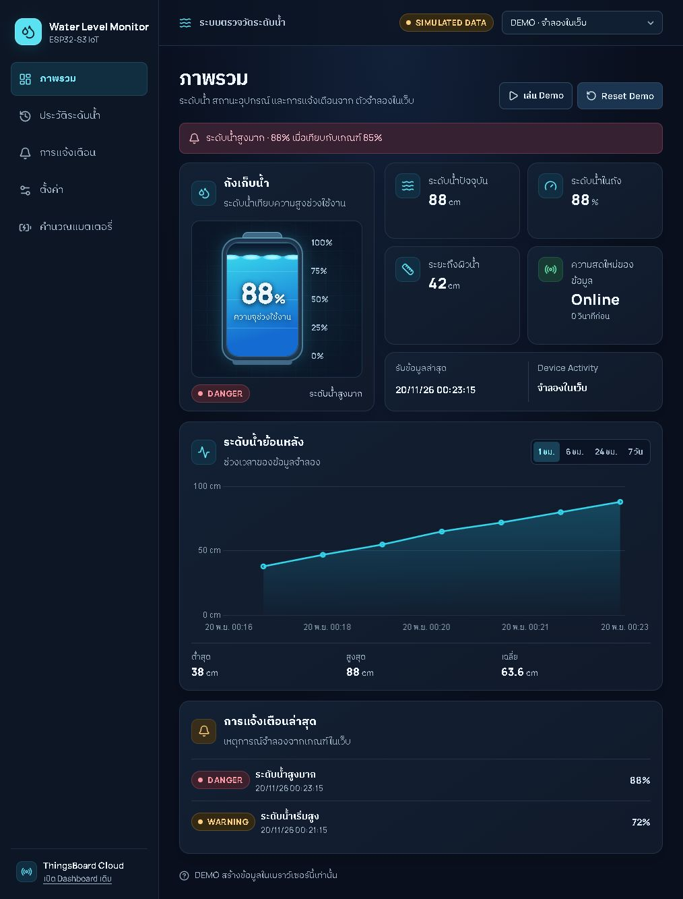

# ESP32-S3 IoT Water Level Monitoring & Alert System

เว็บแอปภาษาไทยสำหรับแสดงระดับน้ำและแจ้งเตือนบนหน้าเว็บ ใช้ React, Vite, Chart.js, Lucide และ Vercel Functions โดยใช้ ThingsBoard Cloud เก็บ Telemetry และ Device Attributes

[เปิด Web App บน Vercel](https://esp32s3-water-level-monitor.vercel.app/) แล้วเลือก **SIM · ESP32-S3-Water-Level-SIM** เพื่อดูข้อมูลจำลองที่บันทึกไว้ใน ThingsBoard Cloud

| แหล่งข้อมูล | การทำงาน |
| --- | --- |
| **DEMO** | ตัวจำลองในเบราว์เซอร์ เพิ่มและลดระดับน้ำผ่านทั้งสามสถานะ มีพัก เล่น และ Reset Demo |
| **SIM · ThingsBoard** | อ่าน Telemetry ที่มีอยู่ใน Device `ESP32-S3-Water-Level-SIM` ผ่าน API จริง ติดป้าย **SIMULATED DATA** |
| **LIVE · ESP32** | อ่าน Device `ESP32-S3-Water-Level` ที่เซิร์ฟเวอร์กำหนดไว้ และแสดงป้าย **LIVE DATA** เมื่อเลือกแหล่งนี้ |



[ภาพหน้าจอมือถือ](screenshots/demo-mobile.jpg) · [เมนูมือถือเมื่อเปิด](screenshots/mobile-menu.jpg) · [ภาพขณะอ่าน SIM จาก ThingsBoard](screenshots/cloud-sim-desktop.jpg)

โปรเจกต์นี้อยู่ใน Repository เดิม โฟลเดอร์ `app/` แยกการ build และ deploy จากไฟล์ Export ใน `dashboard/` และจากหน้า ThingsBoard ที่ใช้อยู่ [Public ThingsBoard Dashboard เดิม](https://thingsboard.cloud/dashboard/6a182b80-e40e-11f1-b8a1-9db681a717b8?publicId=a5b263d0-e40f-11f1-b50d-0302f5370387)

## เปิดใช้งานบน Windows

1. ติดตั้ง Node.js 22.12 ขึ้นไปในสาย 22.x จากนั้นเปิด PowerShell ในโฟลเดอร์ `app/`
2. ติดตั้ง dependency แล้วเปิดเว็บ เครื่องที่เพิ่งติดตั้งสามารถเริ่มด้วย DEMO ได้ทันที

   ```powershell
   npm ci
   npm run dev
   ```

3. เปิด `http://127.0.0.1:5173/` เลือกโหมดในช่องด้านบน ไปที่ **ตั้งค่า** เพื่อเปลี่ยนการคาลิเบรต เกณฑ์แจ้งเตือน หรือช่วงเวลา Offline
4. รัน `npm test` เพื่อตรวจการคำนวณและพฤติกรรม API และ `npm run build` เพื่อสร้างไฟล์สำหรับ deploy

## เปิดการอ่าน ThingsBoard Cloud

คัดลอก `.env.example` เป็น `.env.local` แล้วตั้งค่าต่อไปนี้ก่อนเปิด dev server ใหม่ สำหรับ Vercel ให้ตั้งเป็น Environment Variables ของโปรเจกต์บน Vercel

| ตัวแปร | ค่าที่ใช้ |
| --- | --- |
| `TB_ORIGIN` | `https://thingsboard.cloud` หรือ `https://eu.thingsboard.cloud` ตามภูมิภาค ตัด slash ท้ายออก |
| `TB_ENABLE_CLOUD_READ` | ค่าเริ่มต้น `0` ตั้ง `1` เพื่อเปิด API อ่านข้อมูล |
| `TB_SIM_DEVICE_ID` | UUID ของ Device จำลอง ดูจากหน้ารายละเอียดหรือ Export JSON |
| `TB_PUBLIC_SIM_ID` | ค่า `publicId` จากลิงก์ Public ThingsBoard เดิม ใช้กับ Device จำลองที่ได้รับสิทธิ์ Public เท่านั้น |
| `TB_REAL_DEVICE_ID` | UUID ของ Device จริง เว้นว่างจนกว่าจะเชื่อมบอร์ดและกำหนดสิทธิ์ |
| `TB_API_KEY` | ThingsBoard REST API key จากบัญชี Customer User ที่มีสิทธิ์อ่านเฉพาะ Device ที่อนุญาต ต้องใช้สำหรับ Device จริง และใช้กับ SIM ได้หากไม่ใช้ Public ID |

สำหรับ **SIM สาธารณะ** ระบบเรียก public-login endpoint แบบเดียวกับหน้า ThingsBoard แล้วเก็บ JWT อายุสั้นไว้เฉพาะในหน่วยความจำฝั่งเซิร์ฟเวอร์ สำหรับ **LIVE** ใช้ REST API key ฝั่งเซิร์ฟเวอร์ ส่งผ่าน `X-Authorization` เท่านั้น Device Access Token สำหรับเฟิร์มแวร์มีหน้าที่ส่ง Telemetry และควรเก็บแยกจาก REST API key [ThingsBoard REST API](https://thingsboard.io/docs/paas/reference/rest-api/) · [API keys](https://thingsboard.io/docs/paas/user-guide/security/api-keys/) · [ThingsBoard public login source](https://github.com/thingsboard/thingsboard/blob/master/ui-ngx/src/app/core/auth/auth.service.ts)

เบราว์เซอร์เรียก `/api/telemetry` แบบ same-origin จึงไม่ต้องเปิด CORS ที่ ThingsBoard ตัว Proxy รองรับเฉพาะ GET, ชื่อ Device จากรายการที่เซิร์ฟเวอร์กำหนด และช่วงเวลา 4 แบบ ตัวแอปไม่มี route เขียนข้อมูลหรือสั่งงาน Device เมื่อเปิด Proxy บน deployment สาธารณะ ผู้ถือ URL สามารถอ่านข้อมูลของ Device ที่เปิดไว้ได้ หากข้อมูลจากบอร์ดต้องจำกัดผู้ชม ให้เว้น `TB_REAL_DEVICE_ID` ว่างหรือเพิ่มการยืนยันตัวตนที่ deployment ก่อนเปิดใช้งานจริง

## การคาลิเบรตและแจ้งเตือน

- ระยะที่ใช้คำนวณ = ระยะเซนเซอร์ − ระยะเผื่อติดตั้งเหนือระดับเต็ม
- ระดับน้ำ = ความสูงช่วงใช้งาน − ระยะที่ใช้คำนวณ จำกัดให้อยู่ในช่วง 0 ถึงความสูงที่ตั้ง และแปลงเป็นเปอร์เซ็นต์
- ตัวอย่างในระบบ SIM ใช้ช่วง 100 cm และเผื่อติดตั้ง 30 cm เมื่อเซนเซอร์รายงาน 35 cm จะได้ 95 cm และ 95% เว็บเริ่มด้วย WARNING ที่ 70% และ DANGER ที่ 85% ซึ่งเป็นค่าตัวอย่าง
- ค่า Timeout, `sensorValid=false`, ระยะหาย หรือระยะนอกช่วงขึ้น **Sensor Error** ถ้าไม่มีข้อมูลใหม่จนหมดเวลาที่ตั้งไว้ เว็บแสดง **Offline** พร้อมกำกับค่าครั้งก่อน ส่วน **Device Activity** อ่าน `active` จาก ThingsBoard แยกกัน [ThingsBoard Connectivity Status](https://thingsboard.io/docs/paas/user-guide/connectivity-status/)
- ประวัติและสถิติ 1 ชม., 6 ชม., 24 ชม. และ 7 วันคำนวณจากจุดที่ได้รับจริง API จำกัดที่ 2,500 จุดล่าสุดต่อคีย์ ประวัติแจ้งเตือนเป็นการคำนวณการข้ามเกณฑ์จากจุดที่อ่านได้ การแก้เกณฑ์จะเปลี่ยนผลย้อนหลังของเว็บ
- การแจ้งเตือนในฉบับนี้อยู่บนหน้าเว็บ หากจะเก็บ Alarms ถาวร ให้ใช้ ThingsBoard Device Profile หรือ Rule Chain กับสถานะที่เฟิร์มแวร์ส่ง แล้วเพิ่ม route อ่าน Alarm API ฝั่ง Proxy ตามสิทธิ์ที่กำหนด
- เกณฑ์และการคาลิเบรตบันทึกไว้ในเบราว์เซอร์ แยกตามแหล่งข้อมูล การตั้งค่าเว็บไม่มีผลกับเฟิร์มแวร์

## การต่อ ESP32-S3 ในอนาคต

ยืนยัน Schematic และ PCB Revision ก่อนเลือก GPIO ของ TRIG, ECHO, LED และ Buzzer ตรวจแรงดันสัญญาณของ JSN-SR04T รุ่นจริงกับขาที่ใช้บนบอร์ดก่อนต่อ และคาลิเบรตระยะที่ถังว่างและเต็มก่อนเทียบค่ากับหน้าเว็บ

ตัวอย่าง **รูปแบบ payload** สำหรับรอบที่เซนเซอร์อ่านสำเร็จ

```json
{
  "distance": 65,
  "waterLevel": 65,
  "waterPercent": 65,
  "status": "NORMAL",
  "sensorValid": true,
  "firmwareVersion": "1.0.0",
  "uptime": 120,
  "rssi": -60
}
```

ส่งคีย์ของการวัดรอบเดียวกันใน payload เดียว เมื่ออ่านไม่สำเร็จให้ส่ง `{"sensorValid": false}` ในรอบนั้น เว็บจะอ่าน timestamp ล่าสุดแล้วขึ้น Sensor Error ใช้ `uptime` เป็นวินาที และ `rssi` เป็น dBm

- **HTTPS:** POST JSON ไปที่ `https://thingsboard.cloud/api/v1/<DEVICE_ACCESS_TOKEN>/telemetry` หรือโฮสต์ภูมิภาคของบัญชี เปิดการตรวจ TLS certificate และเก็บ Token ไว้ใน local secrets ของเฟิร์มแวร์ [ThingsBoard HTTP Telemetry](https://thingsboard.io/docs/paas/reference/http-api/telemetry/)
- **MQTT:** เชื่อมโฮสต์ MQTT ของภูมิภาคผ่าน TLS ใช้ Device Access Token เป็น username และ publish JSON ที่ `v1/devices/me/telemetry` [ThingsBoard MQTT Telemetry](https://thingsboard.io/docs/paas/reference/mqtt-api/telemetry/)
- ตรวจ **Latest Telemetry** ของ Device จริงก่อนเพิ่ม UUID ในเว็บ ลองหลายระดับน้ำ วัดระยะด้วยเครื่องมืออ้างอิง และลองหยุดส่งนานกว่า Offline timeout เพื่อตรวจข้อความและไฟแจ้งเตือนบนบอร์ด

## Battery Estimation

พลังงานเซลล์ (Wh) = ความจุ (mAh) ÷ 1,000 × แรงดันเซลล์ (V) คูณประสิทธิภาพเพื่อได้พลังงานที่ใช้ได้ เวลาทำงาน (ชั่วโมง) เท่ากับพลังงานที่ใช้ได้ ÷ [5 V × กระแสเฉลี่ย (mA) ÷ 1,000] ผลเป็นค่าประมาณจากข้อมูลที่กรอก

## Deploy บน Vercel

1. ใน Vercel เลือก **Add New → Project** นำเข้า Repository นี้ ตั้ง **Root Directory** เป็น `app` เลือก Vite และ Node.js 22.x
2. ใช้บัญชีและโปรเจกต์บนแผน **Hobby** หากเข้าเงื่อนไขของ Vercel เลือกเปิดเฉพาะ SIM สำหรับการนำเสนอแบบ public แล้วกด **Deploy** Vercel จะ build `dist/` และผูก `api/telemetry.js` เป็น Function [Vercel Hobby](https://vercel.com/docs/plans/hobby)
3. เปิด Production Domain ที่ Vercel รายงาน ตรวจหน้า DEMO และเลือก **SIM · ESP32-S3-Water-Level-SIM** เมื่อเปิดไว้ ทดสอบ `/api/telemetry?op=devices` จากโดเมนเดียวกันเพื่อยืนยันว่า Function ตอบ JSON
4. หาก Deploy ด้วย CLI ให้เข้าโฟลเดอร์ `app/` แล้วใช้ `npx vercel@latest login` และ `npx vercel@latest deploy --prod` ตั้งค่าลับใน Vercel Environment Variables และ redeploy หลังแก้ไข [คู่มือ Vercel CLI](https://vercel.com/docs/projects/deploy-from-cli)

## การทดสอบ

`npm test` ตรวจการคาลิเบรต ค่าผิดปกติ เกณฑ์แจ้งเตือน สูตรแบตเตอรี่ ขอบเขตของ Proxy และกรณี API ตอบผิดพลาด ทดสอบ API ที่เชื่อม Cloud แล้วอ่าน Device SIM ได้จริง โดยอ่านระยะล่าสุด 35 cm, สถานะ DANGER, Device Activity เป็น false และประวัติ 6 จุดในช่วง 24 ชม. ณ เวลาเก็บผล

ทดสอบเมนูมือถือที่ความกว้าง 320 px ตรวจว่ารายการเมนูทั้งห้าเปิดได้โดยไม่ล้นหน้าจอ ตรวจการปฏิเสธค่า threshold ผิดและการอ่านค่าที่บันทึกหลัง Reload ส่วนการทดสอบบน ESP32-S3 ต้องใช้ PCB เฟิร์มแวร์และสิทธิ์อ่าน Device จริง
